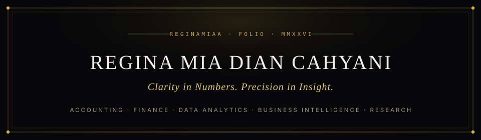

  

 

  
  
  
  
  

 

  

### I. The Ethos

> *"Combining accounting knowledge, analytical thinking, and technology to transform data into meaningful business insights and support evidence-based decision-making."*

- **Background:** Accounting Graduate (*she/her*) based in **Indonesia (`UTC +07:00`)**
- **Focus:** Financial Analysis, Business Intelligence, Data Analytics & Multidisciplinary Business Research
- **Personal Website:** [reginamiaa.github.io](https://reginamiaa.github.io) &middot; [about.me/reginamiadiancahyani](https://about.me/reginamiadiancahyani)

  

### II. Professional Interests &amp; Competencies

| Pillar | Scope &amp; Focus |
| :--- | :--- |
| **Professional Interests** | Accounting &amp; Financial Reporting &middot; Financial Analysis &amp; Modeling &middot; Data Analytics &amp; Business Intelligence &middot; Human Resources Analytics &middot; Business Performance &amp; Strategic Analysis &middot; Applied Research &amp; Statistical Analysis |
| **Current Working Skills** | Microsoft Excel &middot; Microsoft Office &middot; Spreadsheet Management &middot; Basic Financial &amp; Accounting Analysis |
| **Developing Competencies** | SQL &middot; Python &middot; Power BI &middot; Statistical Analysis &middot; Data Visualization &middot; Business Intelligence |
| **Working Principles** | Evidence-based analysis &middot; Data accuracy &amp; validation &middot; Transparent methodology &middot; Reproducible workflows &middot; Ethical data management &middot; Continuous professional development |

  

### III. Academic Dossier

| Period | Credential &amp; Institution | Distinction |
| :--- | :--- | :--- |
| **2017 &ndash; 2021** | **Bachelor&rsquo;s Degree in Accounting** &mdash; *Institut Teknologi Bisnis AAS Indonesia* | **GPA: 3.52 / 4.00 &middot; Cum Laude** |

  

### IV. Featured Portfolio Works

| No. | Area | Project Focus |
| :--- | :--- | :--- |
| `01` | **Accounting** | **[Automated Financial Reporting](https://github.com/reginamiaa/accounting-financial-reporting)** |
| `02` | **Finance** | Financial Performance Analysis |
| `03` | **Data Analytics** | Exploratory Data Analysis |
| `04` | **Business Intelligence** | Interactive KPI Dashboard |
| `05` | **HR Analytics** | Payroll &amp; Workforce Analysis |
| `06` | **Research** | Reproducible Business Research |

*Project repositories will include methodology, documentation, datasets, and reproducible results.*

  

### V. Telemetry

  
  

 

  <em>Building analytical capabilities through continuous learning, practical projects, and evidence-based research.</em>

